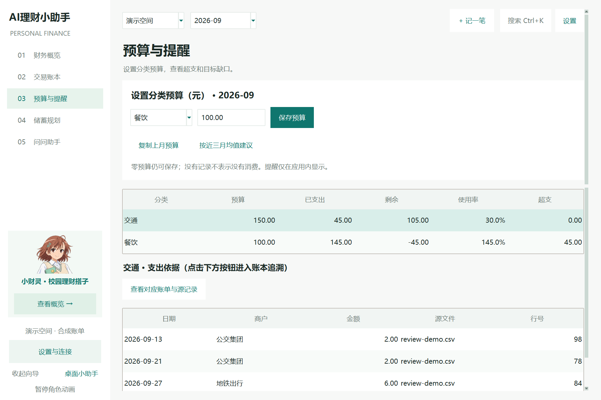

# AI理财小助手 / AIFinanceHelper

[](https://github.com/Jeffspdf/AI-finance-assistant/actions/workflows/test.yml) · [English](README_EN.md) · [评审修复清单](docs/REVIEW_RESPONSE.md)

面向学生的本地人民币收支分析、预算与储蓄规划桌面应用。AI 为可选的分类建议与查询理解工具，金额由 Python 代码计算。默认离线；不是投资顾问或银行账户余额管理器。



## Windows 安装

从 [Releases](https://github.com/Jeffspdf/AI-finance-assistant/releases/latest) 下载 `AIFinanceHelper-0.7.1-Setup-x64.exe`，退出旧版后安装。从桌面或开始菜单打开，无需 Python。ZIP 便携版须完整解压，不能只复制 EXE。安装包未签名，可能出现未知发布者提示。

顶部选择演示空间或我的账本。首次演示默认最近有数据月份；个人账本初始为空。私有数据目录保留为 `%LOCALAPPDATA%\ShiguangLedger`，保证旧版升级兼容，卸载默认保留。请退出程序后备份整个目录；本版尚无一键恢复。

## 桌面版工作流

1. 导入 CSV/XLSX，预览确认有效行；异常/重复/冲突分开报告。使用 `samples/template.csv`，不保证任意银行格式。
2. 账本搜索、分类筛选、分页、双击编辑；原始编号和源文件/行号保留，修改前值写入审计表。
3. 财务概览展示期间收支、趋势和预算使用；点击分类进入源账单。
4. 预算与提醒按月保存分类额度，展示超支/零预算/来源明细和目标缺口。
5. 规划用最近三个完整月估算，或手动输入比较 A/B；每个估算列出来源月份和缺失情况。历史目标可记录实际存入（不会重复生成交易）。
6. 问答优先本地规则。启用模型后支持限定商户、日期区间、两分类比较和三月平均，返回全部计算依据。模型失败不捏造数据。

## 模型与隐私

设置 → 配置模型，填写 Base URL（不含 `/chat/completions`）、模型 ID 和 Key，测试连接后勾选启用与发送许可。远程要求 HTTPS，本机 localhost 可用 HTTP。端点/模型名保存；密钥和启用状态只在本次运行有效。

问答仅发送问题文本。AI 分类需再次确认，发送待确认记录的商户、描述、收支类型，每次最多 20 笔，可能产生费用。返回建议需人工选择接受，来源标注“模型建议（需核对）”；人工修正与规则结果不被覆盖。模型不能执行任意 SQL/代码。没有真实 API 凭据时，不会声称真实模型评测已通过。

## 从源码运行

Windows x64，Python 3.12（带 Tk）：

```powershell
python -m venv .venv
.\.venv\Scripts\python.exe -m pip install -r requirements.txt
.\.venv\Scripts\python.exe desktop.py
```

也可双击 `start_desktop.bat`。网页原型：`python -m streamlit run app.py`，或 `start.ps1`。Streamlit 不是主安装版，新增目标实际存入与扩展问答演示以桌面版为准。

## 验证与复现

```powershell
python -m pytest -q
python scripts/reproduce_acceptance.py
python scripts/evaluate_ai.py
python scripts/verify_review_ui.py
```

完整测试数与验证范围见 [验证记录](docs/VALIDATION.md)，不把合成数据回归称为真实准确率。`reproduce_acceptance.py` 使用固定参考日期 2026-10-09，临时数据库，生成 `samples/acceptance/review_results.json`。UI 脚本仅使用合成数据。`evaluate_ai.py` 默认 mock-oracle，实时模型评测须本地设置 FINANCE_LLM_BASE_URL / FINANCE_LLM_MODEL / FINANCE_LLM_API_KEY，再加 `--live`，会联网且可能计费。

[AI 评测方法与结果](docs/AI_EVALUATION.md) · [架构与设计](docs/ARCHITECTURE.md) · [AI 使用记录](docs/AI_USAGE.md) · [发布说明](WINDOWS_RELEASE.md)

## 边界

金额用整数分，转账不计收支，结余不等于账户余额。仅支持人民币；退款需人工整理，不自动冲销。无编号指纹可能合并完全相同的真实多笔交易，需核对；缺失记录不当作零消费。实际存入基于用户记录，不连接银行、无提现流水。当前不含后台推送、OCR、多币种、云同步、登录、股票预测。

导入已改为后台解析与确认，支持取消结果及异常 CSV 导出；尚未支持逐行排除和手动列映射。尚无干净 Windows 虚拟机与 150% DPI 认证。未制作本次范围之外的课程最终视频、幻灯片、报告；团队身份和真实贡献由成员补充。

## 第二轮体验优化（0.7）

- 顶部“记一笔”或 Ctrl+N；Ctrl+K 搜索商户、分类、金额条件（如 >100）、上月，或跳转页面。
- 首页洞察完全本地计算，每张提供解释与源记录；样本不足会隐藏，不保证始终三张。
- 账本 Ctrl/Shift 多选批量分类，同商户操作限定相同收支类型；可撤销本次运行中最后一次批量。表头点击排序，排序后编辑仍对应原交易。
- 编辑交易可勾选“记住此商户分类”；仅作用于以后新导入的同商户同类型记录，不重写历史。设置可删除规则。
- 预算可复制上月或确认采用近三完整月份均值的90%，不代表最优预算。
- 助手保留本次运行最近20条消息；支持“餐饮占比呢”等有限上下文和“把餐饮预算设为1200”命令，写入前确认。未指定月份的预算命令默认为本月并明确展示，不接受模型直接写库。
- 异步导入可预览、导出全部异常、确认入库。取消解析不会写库，但解析库可能仍在后台完成；提交阶段不允许取消。预览显示前200条，异常完整文件可导出。
- 界面尺寸已由 0.7.1 统一修正：默认1200×800、最小1100×720逻辑像素，按系统 DPI 缩放；屏幕不足时以工作区为上限。正文10pt，表格行高44逻辑像素，主页面单一纵向滚动。

执行 `python scripts/verify_round2_ui.py` 可复现快捷记账、排序定位、批量撤销、对话澄清与确认、异步导入取消/提交和小窗口走查。[第二轮逐项回应](docs/ROUND2_RESPONSE.md)。

## 高 DPI 修复（0.7.1）

窗口、侧栏、角色、间距、表格、弹窗和图表统一使用96 DPI逻辑单位；字体使用正数点值，不再固定像素字号。150%系统缩放下默认窗口1800×1200、正文行高27px。200%模拟下高度受工作区限制，内容纵向滚动，编辑与快速记账保存按钮固定在底部。

首页顺序：收支概览 → 洞察 → 预算。洞察随内容宽度采用2/3列，只有两张时均分宽度。说明文字至少10pt。

运行 `python scripts/verify_dpi_ui.py` 可复现100/125/150/200%模拟和本机原生缩放测试，覆盖六页默认/最小尺寸、九种弹窗/桌面角色和对话换行。详见[第三轮回应](docs/ROUND3_RESPONSE.md)。本机原生150%已验证；其余为Tk模拟，未认证跨不同DPI显示器热切换及干净Windows安装。
