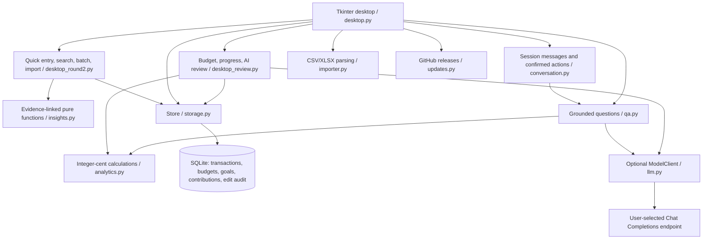

# Architecture and decisions

Money is stored in integer cents. Decimal is used at input and rounding boundaries. Model outputs are labels or constrained query fields; SQL and code execution are never generated by models. A known local question does not call a model. Explicit merchant/date/category conditions must survive validation. A valid new query may expand beyond the local vocabulary; amounts are still computed from imported rows.

Import preserves original IDs, filenames and row numbers. Same platform/ID conflicts do not overwrite existing data. Manual edits append old values to transaction_edits. No-ID fingerprint deduplication may merge genuinely identical transactions; refunds are not auto-reconciled.

Tkinter replaces the original Streamlit UI for Windows installation without a local web server. Streamlit remains a tested prototype. New desktop functionality is isolated in ReviewFeatures to reduce growth of desktop.py. The feature module is not a network service.

Desktop layout units are centralized in ui_scale.py: 96-DPI logical pixels convert once to physical layout sizes; positive point fonts are scaled by Tk. Windows system DPI is read before constructing the UI, after enabling system DPI awareness. Native work-area bounds cap client and minimum window sizes, with title-bar space reserved. Entry character widths, table row counts, relative coordinates and animation milliseconds are not pixel units. Canvas drawing and sprite target dimensions scale explicitly; wrapped labels respond to available width. Mixed-DPI monitor hot switching is not implemented.

SQLite schema 4 adds accounts/funding declarations, unique-hash source documents, raw necessary fields, import batches, link groups/members, migration history and audit. See ROUND4_IMPLEMENTATION.md. Upgrades snapshot first, commit DDL/version atomically, and reject future versions. link_members is authoritative; link_group_id is a trigger-maintained cache. Store.transactions() returns the shared statistical projection and source_transactions() keeps every active source leg. Only valid confirmed purchase_duplicate groups suppress funding legs. Pending refunds/review rows stay visible but do not count. Goal contributions remain additional user-confirmed deposits. Existing saved_cents remains the initial amount allocated to a goal; contributions are additional user-confirmed deposits. Progress is initial amount plus dated contributions. Planned and actual values are shown separately. Deleting a goal removes its contributions in the same transaction. Database contexts commit or roll back, then explicitly close.

Model settings persist endpoint/model and optionally enabled state plus a Windows current-user DPAPI-encrypted credential. The stable user-data path and entropy are independent of installation version. A single atomic JSON replacement prevents mixed endpoint/key saves; decrypted credentials are bound to their endpoint. Startup restores without network calls, failures disable and preserve the original file, and session-only/clear options remove saved secrets. See MODEL_SETTINGS.md. Question understanding sends question text; classification requires separate confirmation and sends merchant/description/kind, at most 20 rows. Suggestions are not saved until selected for acceptance; conditional updates cannot overwrite rules or manual corrections. Closing a suggestion window cancels subsequent requests, but a request already in flight may continue until timeout.

UI and worker threads communicate through queues and Tk after callbacks. No worker directly updates widgets. Budget/analysis remain offline. AI calls, update checks and downloads are explicit. Imports parse on a background worker and wait for user confirmation before a database transaction. Cancellation discards parse results but does not forcibly interrupt the parser; committing is not cancellable. Transaction display is paginated to 200 rows and scrolls with the main page; calculations use the full selected data.

The Windows product name is AI理财小助手 / AIFinanceHelper. The legacy ShiguangLedger installation/data directory and AppId are intentionally stable for upgrade compatibility. Renaming that private directory without migration could lose access to old data, so it is not cosmetic cleanup.

Release downloads compare SHA256 against GitHub release metadata or the official release checksum manifest. This detects transfer/tampering inconsistencies; it is not code signing and does not defend against a compromised publisher account. No third-party mirrors are used.

