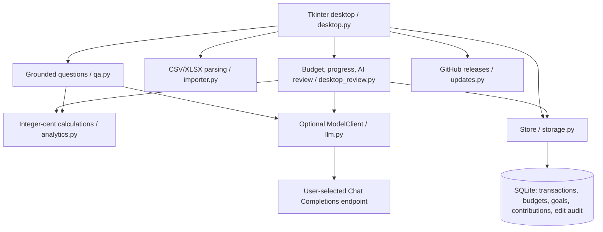

# Architecture and decisions

Money is stored in integer cents. Decimal is used at input and rounding boundaries. Model outputs are labels or constrained query fields; SQL and code execution are never generated by models. A known local question does not call a model. Explicit merchant/date/category conditions must survive validation. A valid new query may expand beyond the local vocabulary; amounts are still computed from imported rows.

Import preserves original IDs, filenames and row numbers. Same platform/ID conflicts do not overwrite existing data. Manual edits append old values to transaction_edits. No-ID fingerprint deduplication may merge genuinely identical transactions; refunds are not auto-reconciled.

Tkinter replaces the original Streamlit UI for Windows installation without a local web server. Streamlit remains a tested prototype. New desktop functionality is isolated in ReviewFeatures to reduce growth of desktop.py. The feature module is not a network service.

SQLite changes are additive: goal_contributions is created if absent (schema user_version=2). Existing saved_cents remains the initial amount allocated to a goal; contributions are additional user-confirmed deposits. Progress is initial amount plus dated contributions. Planned and actual values are shown separately. Deleting a goal removes its contributions in the same transaction. Database contexts commit or roll back, then explicitly close.

Model settings persist endpoint/model only; keys and enable state are session-only. Question understanding sends question text; classification requires separate confirmation and sends merchant/description/kind, at most 20 rows. Suggestions are not saved until selected for acceptance; conditional updates cannot overwrite rules or manual corrections. Closing a suggestion window cancels subsequent requests, but a request already in flight may continue until timeout.

UI and worker threads communicate through queues and Tk after callbacks. No worker directly updates widgets. Budget/analysis remain offline. AI calls, update checks and downloads are explicit. Large imports still parse on the UI thread (documented limitation); transaction display is paginated to 200 rows, while calculations use the full selected data.

The Windows product name is AI理财小助手 / AIFinanceHelper. The legacy ShiguangLedger installation/data directory and AppId are intentionally stable for upgrade compatibility. Renaming that private directory without migration could lose access to old data, so it is not cosmetic cleanup.

Release downloads compare SHA256 against GitHub release metadata or the official release checksum manifest. This detects transfer/tampering inconsistencies; it is not code signing and does not defend against a compromised publisher account. No third-party mirrors are used.
