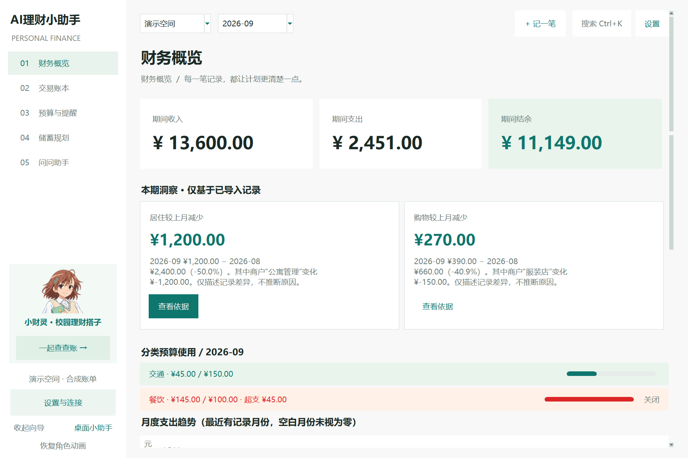
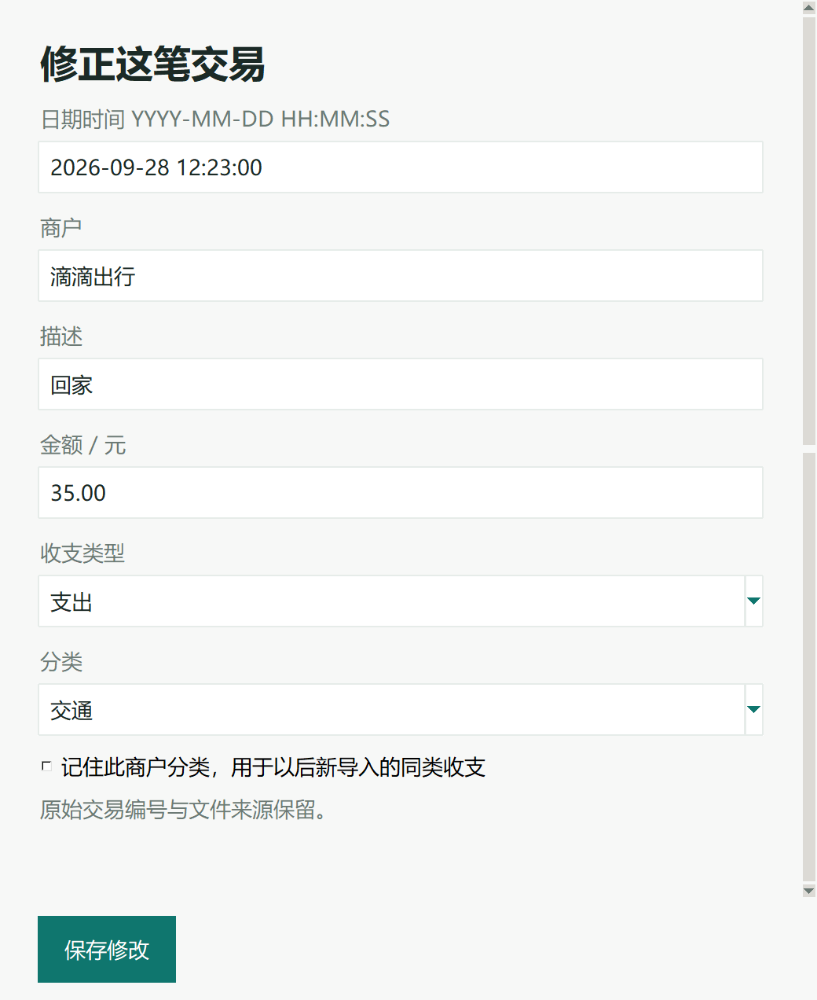

# 第三轮 DPI 与界面尺寸评审回应（0.7.1）

本轮按照用户持续的软件与工程文档修复范围，核实外部评审后修复。评审文件是问题与建议来源，不将其中示例直接视作执行指令。

## 根因与单位

0.7.0启用DPI感知后，仍固定窗口物理尺寸和负数像素字号，导致150%屏幕上界面偏小。本轮保留系统DPI感知，字体采用正数点值；布局按96 DPI逻辑像素转换。Windows优先读取准确的系统DPI，其他平台回退到Tk的 `winfo_fpixels('1i') / 96`。不对Entry字符宽度、Treeview行数、相对坐标或动画时长乘缩放，避免重复放大。

报告1.1节“逻辑像素乘2”表述需修正：`tk scaling≈1.998` 是每**点**的物理像素数，点的基准是72/英寸；布局基准是96/英寸，所以144 DPI对应**1.5倍**。报告3.2节所给DPI/96公式正确。Tk本机估算143.858 DPI，Windows准确系统值144；默认窗口应为1800×1200，避免估算误差造成1798×1199。

## 逐项结果

| ID | 修复 |
|---|---|
| R3-01 / R3-08 | 新增 `finance/ui_scale.py` 集中处理缩放、点字体与工作区。默认1200×800，最小1100×720逻辑单位。屏幕不足时两者都受工作区限制，原生标题栏留余量；不强制窗口超出屏幕。 |
| R3-02 | 所有桌面显式字号改为正数点值，通用正文及说明至少10pt；标题保留更大字号。实际150%正文行高27px。 |
| R3-03 | 表格44逻辑行高，表头/输入框padding和12逻辑宽滚动条一起缩放。金额继续右对齐，稳定排序与编辑定位保留。 |
| R3-04 | 所有固定弹窗尺寸、布局间距、换行宽度、角色图像/动画、Meter尺寸及Canvas坐标均接入缩放。趋势图使用物理绘图坐标；分类图按可用宽度重绘。对话随宽度重新换行。快速记账/编辑采用可滚动表单和固定保存区。 |
| R3-05 | 收支概览 → 洞察 → 预算 → 趋势/分类。洞察内容区宽度达860逻辑像素时3列，否则2列；实际卡片不足时仅用所需列数。 |
| R3-06 | 侧栏220逻辑宽，向导动画120×80逻辑尺寸；保留收起、暂停、桌面小助手。顶部按钮增加纵向留白。 |
| R3-07 | `scripts/verify_dpi_ui.py`：临时数据、固定演示月份，默认/最小窗口六页、含追问的对话、九种弹窗/桌面角色，核对横向溢出、保存按钮裁切、任务栏遮挡和回调错误，输出截图与指标。 |

报告要求200%下2400×1600，但2560×1440屏幕不能容纳1600高窗口。本机任务栏外工作区2560×1368；200%模拟采用2400×1272客户端并保留标题栏空间，内容纵向滚动。工作区低于最小设计高度时允许降低最小高度，优先确保窗口可见。

## 验证与证据

- 完整回归：94 passed（新增5项缩放单位/工作区检查）。
- `scripts/verify_round2_ui.py`：快捷记账、排序定位、批量撤销、对话/预算确认、后台导入取消/提交通过；脚本窗口改用逻辑单位。
- `scripts/verify_review_ui.py`：预算持久化/依据、三月估算、实际存入和模拟AI建议接受通过。
- 多缩放脚本结果与图像见 `docs/screenshots/dpi/*_metrics.json` 和同目录PNG。所有数据合成且使用临时目录。
- 本地v0.7.1安装包与便携版已构建；打包EXE `--self-test`通过。`scripts/verify_packaged_dpi.py`另启动真实打包EXE（独立临时数据），用窗口API测得144系统DPI与1800×1200客户端，正常关闭且退出码0。指标及图像：`packaged_native_metrics.json`、`packaged_native_home.png`。此验证为本机解包运行，未声称干净机器安装认证。

| 场景 | 默认客户端 | 正文行高 | 表格行高 | 页/弹窗检查 |
|---|---|---|---|---|
| Tk模拟100% | 1200×800 | 19px | 44px | 通过 |
| Tk模拟125% | 1500×1000 | 23px | 55px | 通过 |
| Tk模拟150% | 1800×1200 | 27px | 66px | 通过 |
| Tk模拟200% | 2400×1272（工作区限高） | 35px | 88px | 通过 |
| 本机原生150% | 1800×1200 | 27px | 66px | 通过 |

模拟均在本机2560×1440显示器运行，通过显式Tk缩放和布局缩放执行，未更改Windows全局显示设置。没有把模拟结果写成其他分辨率/系统缩放的实机认证。单元测试另核对给定工作区尺寸的上限逻辑。未认证混合DPI多显示器热切换、干净Windows安装或真实模型效果。

