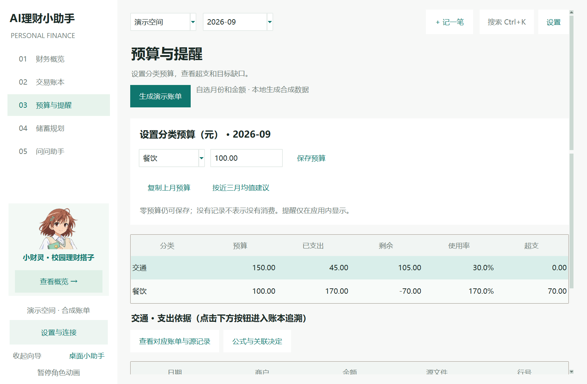
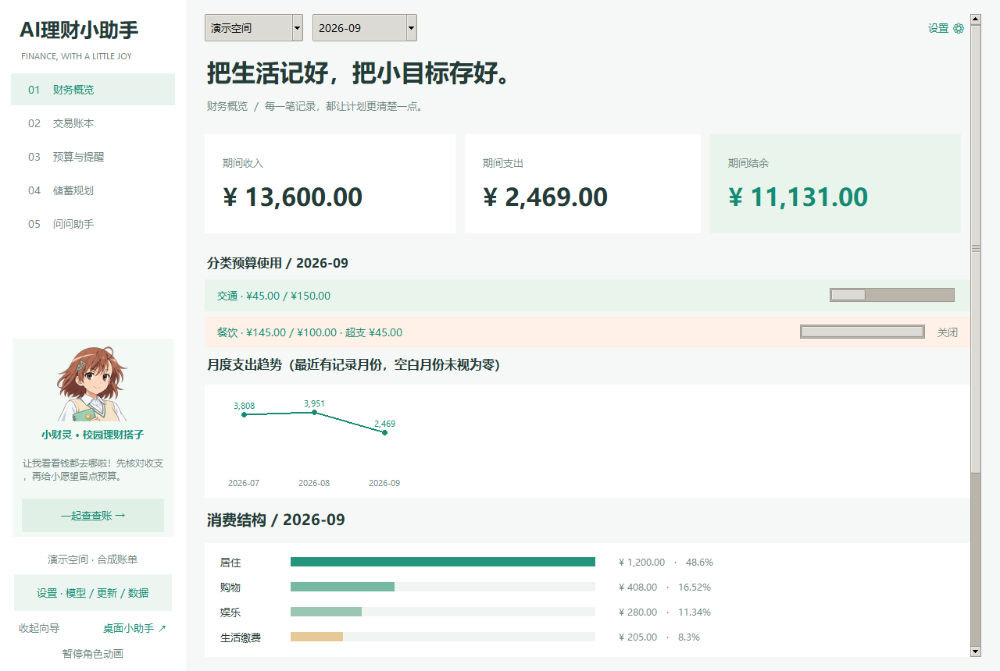
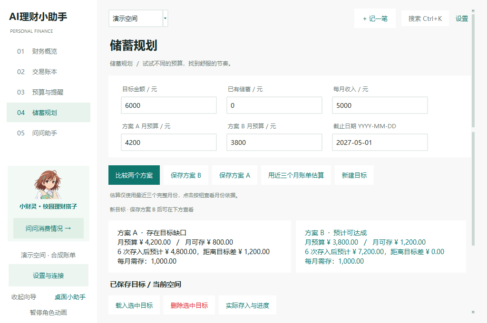

# Validation record — 2026-11-01

Latest: [v0.8.4 seventh-review assessment and E1–E3](ROUND7_RESPONSE.md), **235 tests passed**, with dedicated real-widget and packaged-EXE verification. Historical sections below describe their own releases. All new data is synthetic; no paid model or personal ledger was used.

Code commit `75548de` passed [remote Tests](https://github.com/Jeffspdf/AI-finance-assistant/actions/runs/41665415832). The published0.8.4 installer was downloaded by the actual EXE's updater:37,716,876 bytes, verified SHA256 and explicit current-version status. [Network evidence](packaged_update_network_v084.json). This does not establish code signing or installation on a clean VM.

Previous: [v0.8.3 sixth-round D1–D4](ROUND6_RESPONSE.md), **217 tests passed**. Includes read-only database/audit invariance, legacy semantic backup/repair, transfer validation, explicit zero-wallet acknowledgement and evidence diagnostics. Dedicated GUI checks and actual packaged-EXE checks are recorded there. All new fixtures are synthetic; no paid model or personal ledger was used.

The v0.8.3 code commit `52cffea` passed [remote Tests](https://github.com/Jeffspdf/AI-finance-assistant/actions/runs/41657424224). After publication the actual EXE detected the same version, reported the explicit latest-version status and downloaded all 37,713,629 installer bytes with SHA256 matching official metadata and the local artifact. See [public-metadata-only network evidence](packaged_update_network_v083.json). No installed-client replacement or clean-VM certification is inferred.

Previous: [v0.8.2 fifth-round correctness fixes](ROUND5_RESPONSE.md), **198 tests passed**. Historical category-invalidation cases now use a legal expense-category change; new tests separately reject expense + transfer category. Earlier sections remain chronological records of their releases.

Earlier releases: [v0.8.1 configurable demo generation](DEMO_GENERATOR.md), **169 tests passed**, and [v0.8.0 M1a validation, 2026-11-03](VALIDATION_M1A.md). Earlier sections below remain chronological records of their releases.

## Completed locally

- Full regression: **86 passed**, Python 3.12 / Windows; includes original Streamlit UI tests. Run: `python -m pytest -q`. The first sandbox run stalled on local socket setup; the same suite passed in the normal local execution environment. This is not recorded as an application failure or a skipped test pass.
- Desktop self-test: passes in an isolated FINANCE_DESKTOP_DATA_DIR, including overview, ledger, budget, plan, assistant and settings pages. No personal ledger was modified.
- `python scripts/verify_review_ui.py`: verifies budget persistence, food expense evidence, three-month estimate, actual goal deposits, selected AI suggestion acceptance (mock), source protection and minimum-window controls. It uses temporary databases and synthetic screenshots.
- `python scripts/reproduce_acceptance.py`: 100 unique synthetic rows, repeated import skips 100, 4 invalid rows rejected, Excel parsing passes. September food expense RMB 145, budget RMB 100, overrun RMB 45, **6** source records. Last-three-complete-month average expense = 340333 cents, rounded to cents.
- New regression tests cover migration/contribution cascade, future-deposit rejection, manual category protection, merchant/date/compare/average queries, explicit filter omission, invalid model fields, SHA256 mismatch rejection and official checksum lookup.
- `python scripts/evaluate_ai.py`: 30 authored questions, 10 local + 10 model-only formulations + 10 refusal questions. Default is mock-oracle only. See AI_EVALUATION.md for exact metrics and limitations. No live model claim.

## Evidence

The screenshots are generated from deterministic demo data, then UI test changes (e.g. one accepted mock category). They are not real finances or a live-model demonstration. The reference date of the acceptance dataset is October 9; the real test execution date is November 1.

## Limits

Tests do not establish genuine-model accuracy, arbitrary-bank compatibility, a 50k-row latency guarantee or clean Windows VM installation. The DPI evidence added below is limited to native 150% and explicit Tk simulations, not mixed-monitor certification. Backup/restore and enhanced import cancellation/mapping remain unimplemented. Build, remote publish and remote CI results must be independently observed; source tests alone do not establish their success.

## Build and CI observation

The v0.6.0 packaged EXE passed --self-test with isolated data. The first GitHub review test workflow completed successfully: https://github.com/Jeffspdf/AI-finance-assistant/actions/runs/41282130254 . This run covered the review implementation before the final extra legacy-database test; the local final suite includes that extra test (86 passed). A later evidence-only commit starts a new remote run whose status must be checked separately.

## Second-round validation — v0.7.0

Local complete regression: **89 passed**. `scripts/verify_round2_ui.py` passed at 1024x680, including stable sort/edit identity, multi-row undo, quick entry, session chat/clarification, budget command cancel/confirm, async import cancel-without-write and confirmed commit. Screenshots in this directory now show v0.7 synthetic test data and compact visuals. Windows DPI awareness is enabled, but actual 125%/150% OS scale settings are still not certified. No live model configuration was present; no live-model benchmark was executed. Previous sections record the earlier v0.6 validation chronologically.

## Third-round DPI correction — v0.7.1

Full regression: **94 passed**. Both UI workflow scripts passed again using logical 1100x720 sizing. `scripts/verify_dpi_ui.py` checks six pages at default/minimum widths with real local follow-ups, plus quick entry, transaction edit, goal contributions, answer evidence, model settings, command search, merchant rules, update dialog and desktop pet. It uses isolated synthetic data and makes no model calls. No horizontal page spill, clipped/shortened dialog buttons, taskbar overlap or callback errors were detected.

The local native system is 2560x1440, 150% (Windows144 DPI, Tk143.858 estimate). Native default client size1800x1200, 10pt line height27px, table row66px. Explicit Tk simulations at100/125/150/200% also passed, with a work-area-limited2400x1272 client at200%. The simulations do not change system display settings and are not separate real-machine OS-scale certifications. Metrics and screenshots: [third-round response](ROUND3_RESPONSE.md), screenshots/dpi/*.json and *.png. The root screenshots are refreshed by the workflow scripts; dpi/ contains labelled scale-specific evidence. Mixed-DPI monitor transitions remain untested.

The v0.7.1 installer and portable ZIP were built locally. The actual packaged EXE passed its isolated-data `--self-test`. `scripts/verify_packaged_dpi.py` separately launched that EXE with temporary synthetic data and observed a144-DPI native1800x1200 client through the Windows window API, then closed it normally (exit0). Evidence: screenshots/dpi/packaged_native_metrics.json and packaged_native_home.png. This confirms a local packaged run, not installation on a clean Windows VM.

## API configuration persistence — v0.7.2

Full regression: **106 passed** (94 prior tests plus12 settings-persistence cases). Includes actual Windows current-user DPAPI cross-process decrypt and damaged-blob rejection. Persistence tests also cover legacy/corrupt settings, no plaintext key, startup with model requests blocked, session-only and keyless activation, clear/disable, endpoint tampering, and encryption/atomic-write failures preserving old settings.

`scripts/verify_model_persistence_ui.py` passed seven fresh-process stages: GUI save, restored enabled/key, endpoint change clears input without rewriting old saved config, clear, cleared restart, session-only save, session-only restart. All model requests were blocked; only synthetic keys used. `scripts/verify_dpi_ui.py native` and `... 2` passed six pages at default/minimum size and nine dialogs/pet surfaces; new model form remains scrollable with an unclipped fixed action footer.

The actual v0.7.2 packaged EXE passed `scripts/verify_packaged_model_settings.py`: two fresh launches with synthetic DPAPI credentials in a separate data directory; self-test verifies runtime key/activation equals the independently loaded configuration, and the ciphertext file remains unchanged. No live model request or real credential was used. Installer/data paths and AppId remain unchanged; no clean-machine install or migration of previously unsaved in-memory credentials is claimed.

A1 design documents were added to version control in a separate commit before this fix. They describe later account/reconciliation/refund work and are not runtime features of v0.7.2.

## DeepSeek and update diagnostics — v0.7.3, 2026-11-03

Full offline regression: **114 passed**. New coverage includes official-only DeepSeek non-thinking JSON options, bounded outputs and60-second timeout, empty/truncated/malformed responses, distinct authentication/balance/timeout messages, trusted release-page fallback when GitHub API times out, and one transient download-connect retry with checksum still required.

`scripts/verify_connection_updates_ui.py` passed in isolated synthetic data: timeout/402 messages, same-version download enabled after public-page fallback, successful download UI with mocked file transfer, and SHA256 mismatch shown accurately. `scripts/verify_dpi_ui.py native` passed current150% checks. Actual packaged EXE passed two fresh encrypted-configuration restore/self-test launches.

With explicit user authorization, a private diagnostic loaded the user's encrypted key only in memory and called the official DeepSeek model listing and a128-output-token connection test. Authentication/model availability and completion succeeded (about0.69seconds), with no ledger transmission. This is a connectivity result, not a live categorization/QA benchmark; credentials and raw provider responses are not published. Old failure's exact exception was not captured, so the20-second/default-thinking mismatch is an identified compatibility risk, not a proven explanation for every prior failure.

The public GitHub release API returned403 with remaining quota0; the official page still resolved and the original in-app download path completed the v0.7.2 installer in43.27seconds with valid SHA256. New UI keeps application downloads available even for the installed current version and when using the official-page fallback. See [diagnostic record](CONNECTION_UPDATE_FIX.md).

Local automatic overwrite installation was attempted after user approval but Windows denied access to the existing uninstaller; Setup rolled back. That attempt does not establish installed-v0.7.3 success. The user was given the completed local installer for manual installation; packaged execution is independently verified above.

## Frozen HTTPS root cause — v0.7.4, 2026-11-03

The user subsequently installed0.7.3 manually and still reported failed updates. A diagnostic entry point in the actual frozen EXE reproduced **FileNotFoundError before any request**, in ssl.SSLContext.__new__/load_verify_locations: the local build interpreter expects its adjacent public certificate resource codex-rejected-cas.pem, but earlier local installers omitted it. This is the captured packaging root cause. Earlier live-key and download probes executed in Python, where that resource existed, and did not establish that the prior desktop EXE could use HTTPS.

Packaging now conditionally includes the build runtime's906-byte public TLS resource, with no private keys, trust-code changes, verification bypass or OS certificate-store edits. Official CPython builds without the custom requirement need no extra data. Every installer build must first pass the actual packaged HTTPS-context/UI self-test; CI uses that gate rather than duplicating a second packaged smoke step.

Final offline regression: **123 passed**. UI checks cover explicit current-version status, failure not masquerading as latest, download progress/checksum and no older-version download. Native150% layout and two synthetic encrypted-settings restart/self-tests passed. The fixed actual EXE executed check+complete download+SHA256 successfully; before publishing0.7.4 it correctly detected the then-public0.7.3 and labelled it older than its own build. See [actual executable report](packaged_update_network.json), [root-cause record](UPDATE_ROUTES_074.md).

Transport hardening additionally rebuilds proxy handlers per request, switches from system route to direct official GitHub and then the trusted release page when needed, handles malformed metadata and mid-transfer failure, and retains checksum/cancellation guarantees. The report recorded system-API403, a direct-API timeout, successful official-page fallback and verified full transfer. Bounded local diagnostic events contain no credentials/ledger data.

Attempting to add only the missing public resource to the existing installation was also denied by the current automation environment. Existing user config/ledgers were not modified; this is not claimed as installed-client repair. The completed installer must be run manually once to replace the broken local package. Old binaries cannot fetch their own fix without functional HTTPS.

Post-publication verification: the actual0.7.4 EXE detected the published0.7.4 release via the direct GitHub API route, displayed “当前已是最新版本：v0.7.4。”, downloaded37,617,294 bytes and matched both the official SHA256 and the locally built installer (`c8c0922bd22a7e1e05531a1ed361949a48f1a445dbc6f67adc8f81a88224beeb`). The user then manually installed0.7.4 and explicitly confirmed the client displays “当前已是最新版本”. This confirms the user-visible detection result; no screenshot or separate user download-success claim is inferred.

